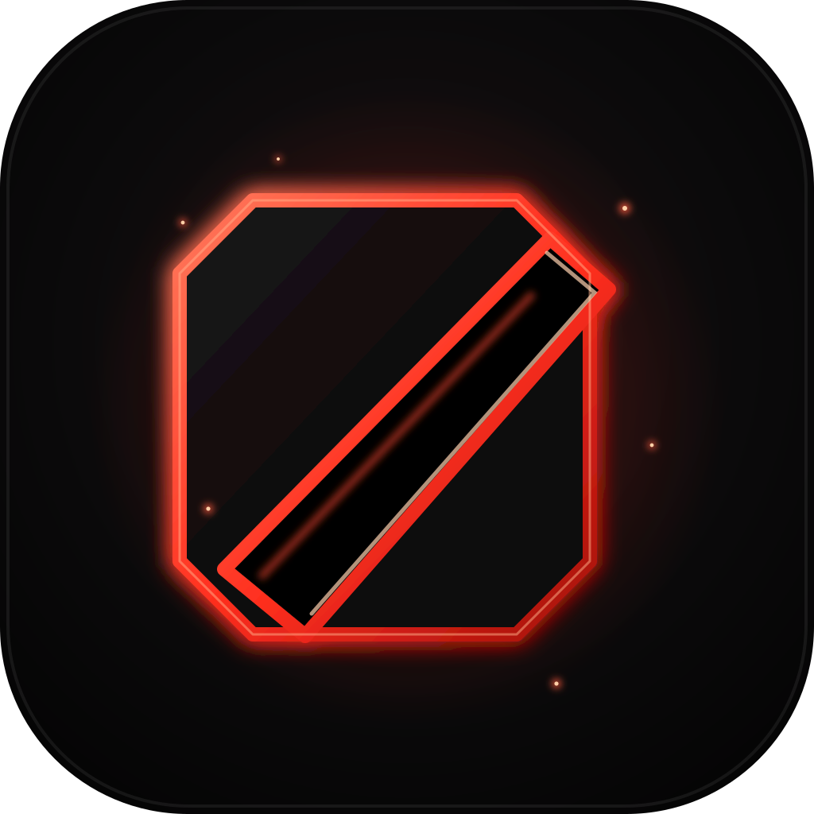

# Dota Improviser

<p align="center"></p>

**A local-first Dota 2 companion for draft planning, item decisions, match review, and practice.**

Dota Improviser combines public match aggregates, read-only local Steam/Dota discovery, user-entered picks, and Dota's opt-in Game State Integration (GSI) feed. The dashboard and overlay are designed for Windows and macOS.

> **Fair-play status:** live overlay coaching is currently restricted to supported local practice sessions. Ranked live coaching is disabled. The app does not read game memory, capture the screen, inspect packets, automate inputs, or reveal hidden information.

**[⬇ Download the latest release](https://github.com/abhibizz158/dota-improviser/releases/latest)** — macOS (Apple Silicon or Intel `.pkg`) and Windows (x64 `.exe`).

On macOS, open the PKG for your chip. It installs or upgrades **Dota Improviser.app** in **Applications**. On Windows, run the x64 setup EXE. Quit Dota Improviser before upgrading. The installers leave your linked Dota account, settings, cached data, and saved Puter sign-in in the existing local profile. An older ad hoc signed macOS build may prompt you to approve Keychain access again.

The app checks for updates shortly after startup and every six hours with no setup needed, downloads a verified matching installer in the background, then offers **Install** in **Settings → App updates**. Connecting a GitHub token there is optional — only useful if you hit GitHub's unauthenticated rate limit (60 requests/hour).

## What it does

- **Overview and match history:** summarize recent games and show available win rate, KDA, GPM, XPM, last hits, denies, and performance trends. Coverage depends on OpenDota availability and Dota's **Expose Public Match Data** setting.
- **Match Review:** inspect parsed timelines, item timings, objectives, and performance against comparable games when the data exists. Unparsed or unavailable fields are labeled as such.
- **Draft & Builds:** manually enter revealed or known hero picks, compare counters and team fit, plan item purchases, inspect item effects and hero-level stat scaling, and save a personal build for practice.
- **Know:** search Dota terminology and mechanics, compare public hero matchup samples, and explore counter-item options. Purchase times are estimates based on observed GPM and unspent gold, not guarantees.
- **Live & Coach:** in supported local practice games, show an own-player lane card with the clock and available player-visible stats. Defensive lane advice and personal pace comparisons appear only when the necessary own-player data is available.
- **Optional Puter AI:** ask strategy questions grounded in selected app data. Sign in from **Settings → Puter AI** using your browser. The AI is optional; its model availability and usage limits are set by Puter.
- **Local Dota and Steam discovery:** detect the installed game, build number, Steam account selection, and local item builds. The local game files do not provide completed match history; that comes from public/cached OpenDota data or a match ID.

### Your history with public sharing off

Use **Overview → Import own matches** to paste up to 20 of your own completed scoreboards as CSV or tab-separated rows. The import dialog shows the column order and opens Steam's personal game data page. These rows stay on your device. To collect future games, opt in to **Save my completed match stats locally** in **Live & Coach** and connect GSI. It saves your own summary only when the feed supplies a completed result and cannot retrieve games from before it was enabled. The ranked overlay remains disabled.

## Requirements

- Windows 10/11 or macOS for the desktop app.
- Node.js 24 or newer and npm for development/building.
- Python 3 and a native C++ toolchain to build automatic display detection. See the [build checklist](docs/release-checklist.md).
- Steam and Dota 2 are optional for dashboard development, and needed for local game discovery and GSI practice setup.

## Run from source

```sh
git clone https://github.com/abhibizz158/dota-improviser.git
cd dota-improviser
npm ci
npm run dev
```

The first launch shows a sample workspace until you add a Dota account ID or open a completed match by ID. You can use a numeric Dota account ID, a SteamID64, or the Steam account detected on this computer. Signing into Steam is not required for the manual workflow.

## Local practice setup

1. Open **Live & Coach** and link the Dota account that will play the practice match.
2. Let the app locate Dota, or use Steam's **Browse local files** to find the installation.
3. Install the generated `gamestate_integration_dota_improviser.cfg` into `game/dota/cfg/gamestate_integration` in the Dota installation.
4. Add `-gamestateintegration` to Dota 2's Steam launch options, then restart Dota.
5. Start the listener and enter a supported local practice lobby. The overlay supports windowed/borderless play where available. Use **Companion** layout if an overlay cannot display reliably above the game.

In **Live & Coach → Display preferences**, select **Follow Dota** and **Auto** placement to put the draft card in the upper left and the lane card in the upper right of the detected game window. Pick a specific monitor and corner if you prefer. The cards pass clicks through to Dota. To edit draft picks, press **Ctrl/⌘ + Shift + F9** or use **Edit draft overlay**. **Done**, **Esc**, or leaving the editor restores click-through. **Ctrl/⌘ + Shift + F10** hides the overlay.

The GSI receiver listens on `127.0.0.1:43182` and authenticates updates with a per-install token. Live updates are transient; raw packets are not retained. The app validates updates in the desktop process and only exposes allowlisted own-player data. Clearing local app data also rotates the token, so reinstall the generated config afterward. Spectator/replay contexts, unknown contexts, stale updates, and unsupported matches must not populate the live player card.

## Puter AI and privacy

Puter is optional. Open **Settings → Puter AI → Sign in with Puter** to use the browser-based login. The app stores the session using Electron's OS-backed secure storage when available; otherwise, it keeps the session for the current run. You can disconnect Puter or clear the app's local data in Settings.

When you ask a question, the app may send the question, selected hero and picks, selected item data, relevant local hero/patch/matchup references, and supported own-player practice values such as clock, GPM, and unspent gold. It does **not** send Steam account IDs or personal match history to Puter. Review each prompt before submitting it. Puter usage is governed by your Puter account and its current plan.

See [Privacy and fair-play boundaries](docs/privacy-and-safety.md) for the full data-flow summary.

## Data sources and limitations

- **OpenDota:** public match history, parsed match details, hero matchups, benchmark percentiles, item popularity, and item timing aggregates. Results may be missing, delayed, rate-limited, or unavailable for private matches.
- **Valve Dota data feeds:** hero/ability metadata and patch notes.
- **dotaconstants:** hero, item, and patch catalogue.
- **Local Steam/Dota files:** read-only discovery of `loginusers.vdf`, `steam.inf`, and `itembuilds/`.
- **Dota GSI:** explicit local opt-in for player-visible game updates. GSI output varies by mode and phase; the application only uses verified, allowlisted fields.
- **Manual picks:** the player may type picks that Dota has not exposed. The app does not infer or reveal unrevealed enemy picks.

Recommendations are guidance, not predictions or instructions. Matchup sample sizes and data scope should be considered before drawing conclusions. The app makes no claim that an overlay is permitted in ranked play; ranked live coaching remains off pending feature- and platform-specific qualification.

## Development commands

| Command | Purpose |
| --- | --- |
| `npm run dev` | Build and launch the Electron app |
| `npm run check` | Type-check renderer and desktop-process code |
| `npm test` | Build and run unit and fair-play guardrail tests |
| `npm run build` | Create the production UI and desktop-process build in `dist/` |
| `npm run preview` | Build and serve the sample UI locally |
| `npm run data` | Fetch/rebuild the generated public hero, matchup, kit, and timing datasets in `data/` |
| `npm run seed` | Rebuild only the hero matchup seed |
| `npm run package:local` | Package a local Apple Silicon macOS app |
| `npm run package:mac` / `npm run package:mac-intel` | Package macOS Apple Silicon / Intel test builds |
| `npm run package:win` | Package a Windows x64 test build |

`npm run data` makes many public requests and can take several minutes; respect OpenDota rate limits. Generated `data/`, `dist/`, and `release/` artifacts are intentionally ignored by Git. The desktop app can refresh public datasets into its local application data folder. Use `npm test` before proposing changes to data parsing, GSI boundaries, draft scoring, or packaging.

Packaging scripts create **private test builds**. Build and verify on each target operating system before distributing. See [the release checklist](docs/release-checklist.md).

## Project documentation

- [Architecture and data flow](docs/architecture.md)
- [Privacy and fair-play boundaries](docs/privacy-and-safety.md)
- [Build and release checklist](docs/release-checklist.md)
- [Agent and contributor workflow](AGENTS.md)

## References

- [OpenDota API](https://opendota.apidocumentation.com/)
- [Valve Dota 2 data feeds](https://www.dota2.com/datafeed/herodata)
- [Dota Game State Integration reference](https://github.com/xzion/dota2-gsi)
- [Steam Hero Builds](https://www.dota2.com/workshop/builds/overview?l=english)
- [Puter authentication](https://docs.puter.com/Auth/signIn/) and [AI chat](https://docs.puter.com/AI/chat/)
- [Valve's Dota Plus lane and build suggestions](https://www.dota2.com/plus/?l=english)
- [Dota Watch](https://github.com/c00kie17/dota-watch), a reference for a separate match-discovery/watch feature

## License and assets

This repository includes the MIT-licensed `dotaconstants` package as a dependency. Dota 2 names, artwork, and game data are Valve's property; included artwork is used as game-related reference material. OpenDota and Puter are external services with their own terms and availability. Review their current terms before redistributing this app.
