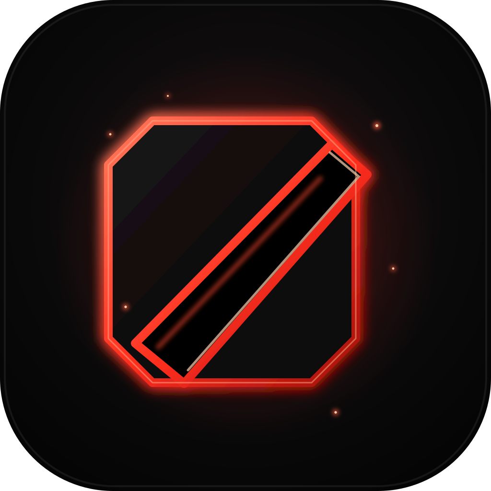

# Dota Improviser

<p align="center"></p>

<p align="center"><strong>A desktop companion for Dota 2 — draft help, live coaching, match review, and achievements, built around your own games.</strong></p>

<p align="center">
  <strong><a href="https://github.com/abhibizz158/dota-improviser/releases/latest">⬇ Download the latest release</a></strong><br>
  <sub>macOS (Apple Silicon) and Windows (x64)</sub>
</p>

---

## What is this?

Dota Improviser sits alongside Dota 2 and helps with three things:

1. **Before the game** — pick a hero with counter and matchup data, plan an item build, and see how it compares to what you actually buy.
2. **During the game** — a small on-screen overlay shows your stats, a live win estimate, matchup-aware item suggestions, map timing reminders (runes, day/night, creep stacks), and achievement pop-ups.
3. **After the game** — review what happened minute by minute, track your achievements and trophies, and let the app learn your playstyle over time so its advice gets more personal the more you play.

Everything it knows comes from places any player can already see: public match stats (OpenDota), Dota's own opt-in live data feed (GSI), your local game files, and whatever you type in yourself. It never reads hidden information, never touches game memory, and never automates anything inside the game — see [**Fair play**](#fair-play) below.

## Features

- **Draft help** — counters, matchup win rates, and team-composition advice while you're picking, plus a personal item build planner.
- **Live overlay** — your stats, a win estimate, matchup item suggestions, and map-timing reminders (runes, day/night, creep stacking) during the match.
- **Achievements & trophies** — kill streaks, multi-kills, milestones, and per-hero item-timing goals, organized by rarity.
- **Match Review** — a minute-by-minute replay of a finished match: gold/XP lead, objectives, your item timing, and your own benchmark comparison.
- **Learns from your games** — the more matches it sees, the more its suggestions adjust to your own comfort on a hero, your real item habits, and situations you've actually been in before.
- **Optional AI assistant** — ask a question about your current draft or game (Puter AI, sign-in required, fully optional).
- **Runs in the background** — closing the window keeps it running quietly from the system tray/menu bar so live coaching keeps working.

## Fair play

Dota Improviser only uses information a player is already allowed to see:

- **Public stats** (OpenDota) and Dota's own **opt-in live data feed** (GSI) — never game memory, packets, or input automation.
- **Draft Vision** (off by default) reads one small strip of *your own screen* — the pick-bar portraits — only during hero selection, and never once a game is live. It's the one narrow exception, used only because Dota doesn't otherwise report picks to the player.
- The app never reveals hidden enemy information, map/vision state, or anything the game itself wouldn't show you.

Full details: [AGENTS.md](AGENTS.md#draft-vision-the-screen-reading-exceptions) and [Privacy and fair-play boundaries](docs/privacy-and-safety.md).

## Install

1. **[Download the latest release](https://github.com/abhibizz158/dota-improviser/releases/latest)** — pick the macOS `.pkg` or Windows `.exe`.
2. **macOS:** open the `.pkg` and install. **Windows:** run the installer.
3. Quit Dota Improviser before installing an update over it. Your linked account, settings, and saved data all carry over.

The app checks for updates automatically and installs them in the background once you approve — see **Settings → App updates**.

## Getting set up for live coaching

1. Open **Live & Coach** and link the Dota account you'll play on.
2. Let the app find your Dota install (or point it there yourself).
3. Install the generated GSI config file it gives you — one click.
4. Add `-gamestateintegration` to Dota 2's launch options in Steam, then restart Dota.
5. Start the listener and play a supported match. The overlay follows the game window automatically.

Hotkeys: **Ctrl/⌘+Shift+O** opens the overlay for editing · **Ctrl/⌘+Shift+C** toggles compact/large · **Ctrl/⌘+Shift+H** hides it.

## Data sources

| Source | Used for |
| --- | --- |
| OpenDota | Match history, parsed replays, hero matchups, benchmarks, item popularity |
| Dota GSI | Your own live in-game stats (opt-in, local only) |
| Valve's own data feeds | Hero/ability data, patch notes |
| Local Steam/Dota files | Finding your install, reading your account, read-only |
| What you type in | Picks Dota hasn't revealed yet |

Recommendations are guidance based on real data, not guarantees — sample sizes vary, and the app says so when data is thin.

## Running it from source

```sh
git clone https://github.com/abhibizz158/dota-improviser.git
cd dota-improviser
npm ci
npm run dev
```

Requires Node.js 24+ and npm. Python 3 and a C++ toolchain are needed to build the optional window-detection module — see the [build checklist](docs/release-checklist.md). Steam and Dota 2 are only needed for local game discovery and live testing, not for working on the dashboard.

| Command | What it does |
| --- | --- |
| `npm run dev` | Build and launch the app |
| `npm run check` | Type-check everything |
| `npm test` | Run the test suite (including the fair-play guardrail tests) |
| `npm run build` | Production build |
| `npm run preview` | Serve a browser preview (no Electron needed) |
| `npm run data` | Refresh the bundled hero/matchup/item datasets |
| `npm run package:mac` / `package:win` | Build a local test package |

## Learn more

- [How it's built](docs/architecture.md)
- [Privacy and fair play, in full](docs/privacy-and-safety.md)
- [Build and release checklist](docs/release-checklist.md)
- [Contributor/agent notes](AGENTS.md)

## License

Copyright © 2026 abhibizz158. Personal use is covered by the [Dota Improviser Personal Use License](LICENSE) — share the official release link freely; redistributing, repackaging, or selling the app needs written permission. Third-party credits: [licenses/README.md](licenses/README.md).
