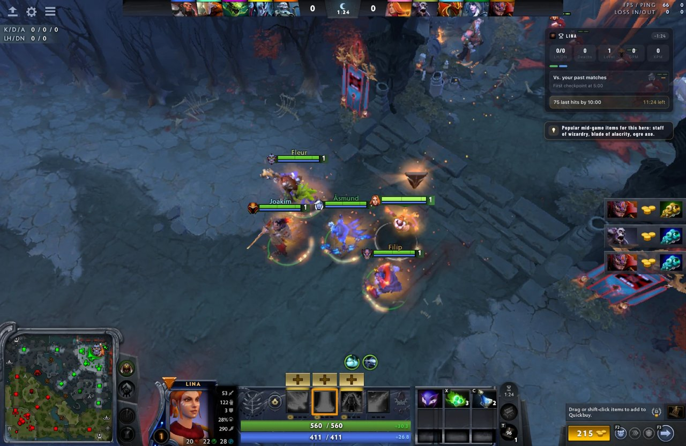
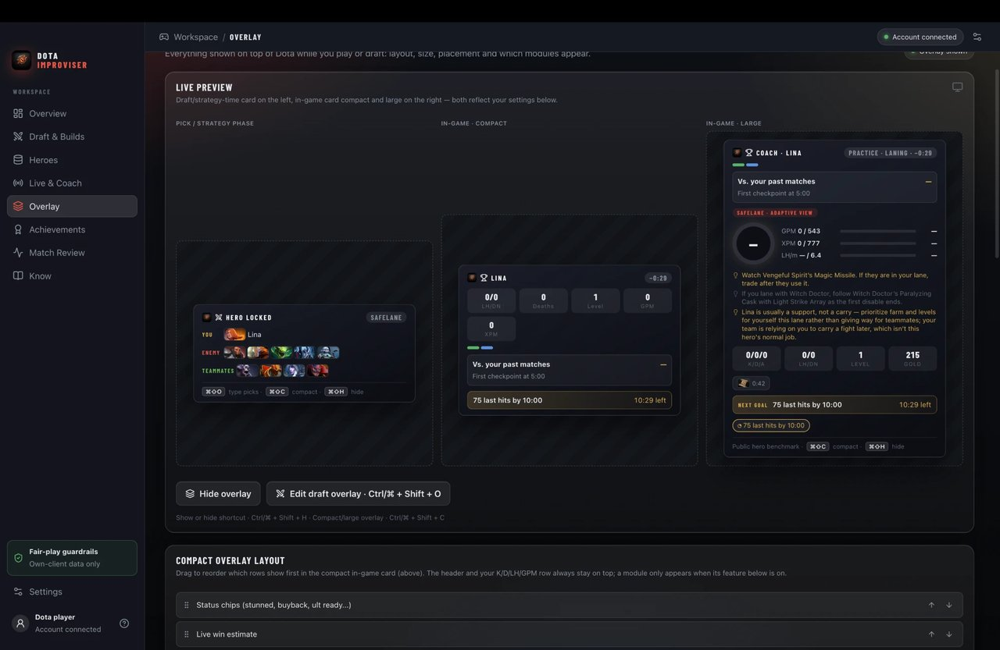

# Dota Improviser

<p align="center"></p>

<p align="center"><strong>A free desktop companion for Dota 2 — draft help, a live overlay, match review, and achievements, built around your own games.</strong></p>

<p align="center">
  <strong><a href="https://github.com/abhibizz158/dota-improviser/releases/latest">⬇ Download the latest release</a></strong><br>
  <sub>macOS (Apple Silicon) and Windows (x64) — free, no account required to try it</sub>
</p>

---

### A fan-made passion project

Built for fun by a Dota player, for Dota players. **Free, open, and not monetized** — no ads, no premium tier, no paywalls, no data selling. Not affiliated with or endorsed by Valve. If you like it, the best thing you can do is just enjoy it and tell a friend.

## Screenshots

| Draft help | Live overlay in-game | Customize the overlay |
| :---: | :---: | :---: |
|  |  |  |
| Counters, matchups, and item advice while you plan | Your stats, win estimate, and tips right over the game | Pick what shows, where, and how big |

## What it does

- **Helps you draft** — shows counters, matchup win rates, and what your team is missing, before the game even starts.
- **Coaches you live** — a small overlay on top of Dota with your stats, a live win estimate, item suggestions for what you're facing, and reminders for runes, day/night, and stacking.
- **Reviews your games** — a clean, minute-by-minute breakdown after the match: who got ahead and when, your item timing, objectives.
- **Tracks your achievements** — kill streaks, multi-kills, milestones, and per-hero goals, all in one trophy case.
- **Learns your style** — the more you play, the more its advice fits *you*: your comfort picks, your real item habits, your past games against similar lineups.
- **Has an optional AI assistant** — ask it a question about your draft or your current game, if you want a second opinion.
- **Stays out of the way** — closes to the system tray, follows Dota's window automatically, and never covers more than a small corner of your screen.

## Keeping it fair

- Only uses what you could already see yourself: public stats, Dota's own opt-in live feed, your own local files, and whatever you type in.
- Never reads hidden information, never touches game memory, never clicks or types for you.
- One narrow, opt-in exception reads a thin strip of *your own screen* during hero picks (since Dota doesn't otherwise tell you who got picked) — off by default, and never used once a game is live.

More detail, if you want it: [Privacy and fair-play notes](docs/privacy-and-safety.md).

## Install

1. **[Download the latest release](https://github.com/abhibizz158/dota-improviser/releases/latest)** — pick the macOS `.pkg` or Windows `.exe`.
2. **macOS:** open the `.pkg` and install. **Windows:** run the installer.
3. Open it, link your Dota account, and follow the one-time setup for the live overlay (Settings walks you through it).

The app checks for updates itself and installs them quietly in the background once you approve.

## For developers

```sh
git clone https://github.com/abhibizz158/dota-improviser.git
cd dota-improviser
npm ci
npm run dev
```

Requires Node.js 24+. See [AGENTS.md](AGENTS.md) and [docs/architecture.md](docs/architecture.md) for how it's built, and [docs/release-checklist.md](docs/release-checklist.md) for packaging.

## License

Copyright © 2026 abhibizz158. Personal, non-commercial use is covered by the [Dota Improviser Personal Use License](LICENSE) — share the official release link freely; redistributing, repackaging, or selling the app needs written permission. Third-party credits: [licenses/README.md](licenses/README.md).
