# Dota Improviser

<strong>A free desktop companion for Dota 2 — draft help, a live overlay, match review, and achievements, built around your own games.</strong>

  <strong>🌐 Official website: <a href="https://dotaimproviser.pages.dev/">dotaimproviser.pages.dev</a></strong> 
  <strong><a href="https://dotaimproviser.pages.dev/demo/">Try it in your browser</a> · <a href="https://github.com/abhibizz158/dota-improviser/releases/latest">⬇ Download the latest release</a></strong> 
  macOS (Apple Silicon) and Windows (x64) — free, no account required to try it

  <a href="https://dotaimproviser.pages.dev/about">About Dota Improviser</a> ·
  <a href="https://dotaimproviser.pages.dev/install">Install guide</a> ·
  <a href="https://dotaimproviser.pages.dev/safety">Safety and fair play</a> ·
  <a href="https://dotaimproviser.pages.dev/updates">What's new</a> ·
  <a href="https://dotaimproviser.pages.dev/support">Help and contact</a> ·
  <a href="https://dotaimproviser.pages.dev/terms">Terms</a> ·
  <a href="https://dotaimproviser.pages.dev/privacy">Privacy</a>

---

### A fan-made passion project

Built for fun by a Dota player, for Dota players. **Free and not monetized** — no ads, no premium tier, no paywalls, no data selling. Not affiliated with or endorsed by Valve. If you like it, the best thing you can do is just enjoy it and tell a friend.

## Screenshots

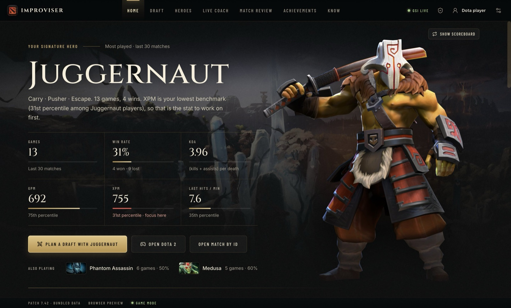 Home: your most-played hero, how you compare with everyone else on it, and what to work on next

| Your performance | Draft help |
| :---: | :---: |
| 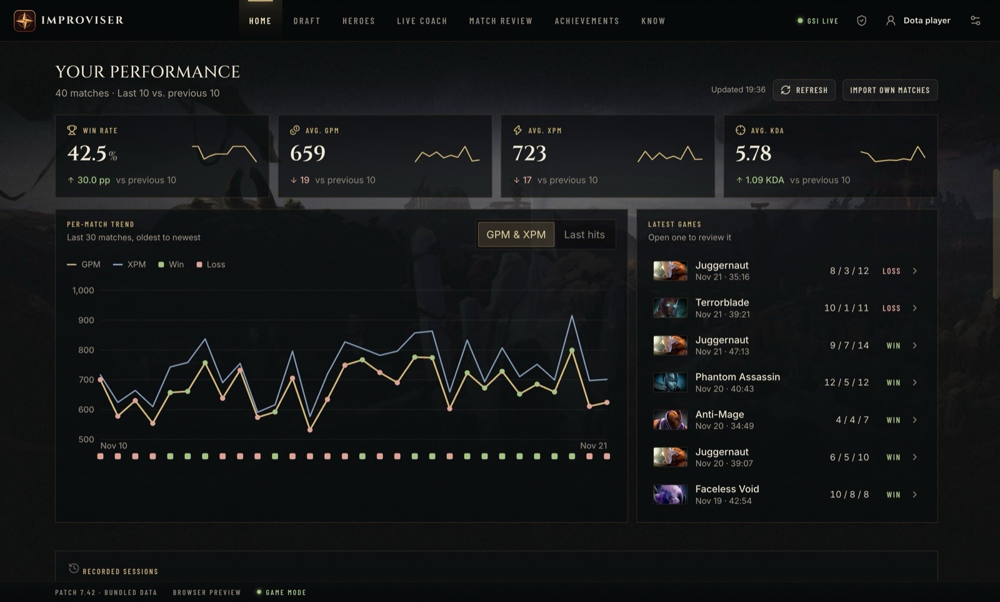 | 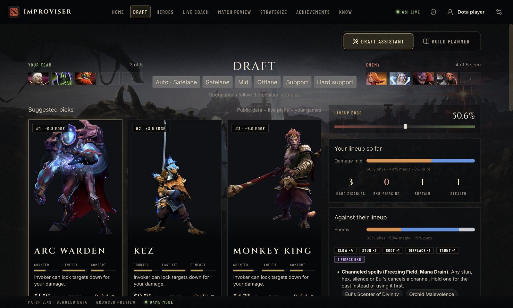 |
| Win rate, GPM, XPM and KDA over your recent games | Three suggested picks with counter, lane fit and comfort, plus lineup analysis |
| **Planner simulator** | **Hero database** |
| 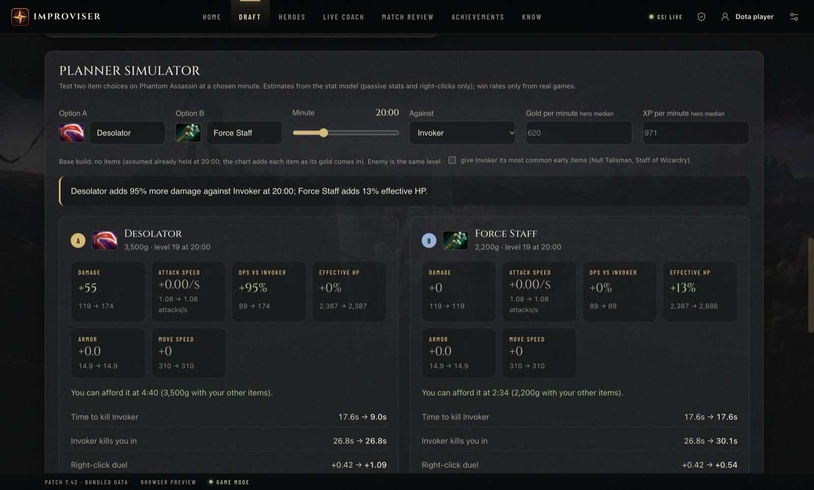 | 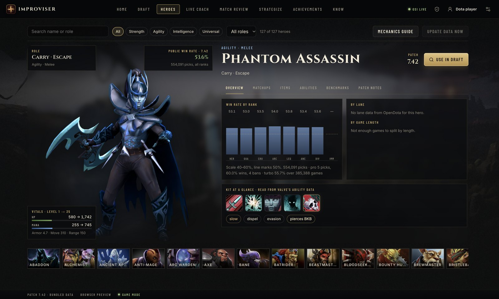 |
| Two items at a chosen minute, against a chosen enemy | Full hero render with role, win rate and vitals; tabs fit one screen |
| **Abilities** | **Achievements** |
| 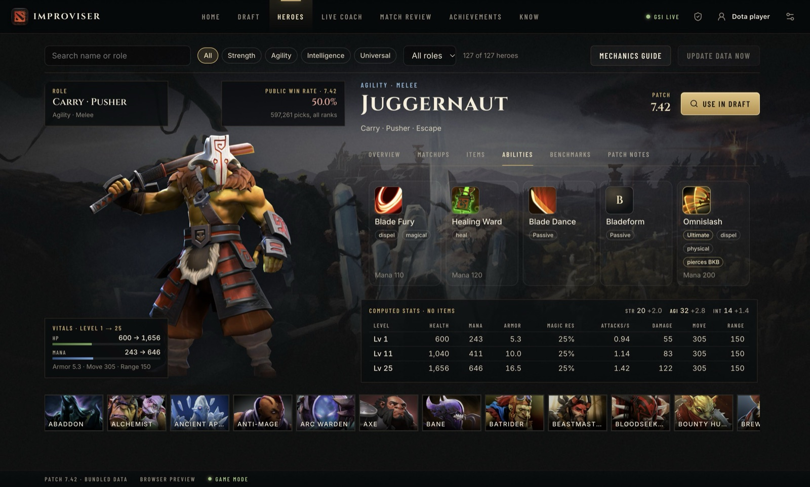 | 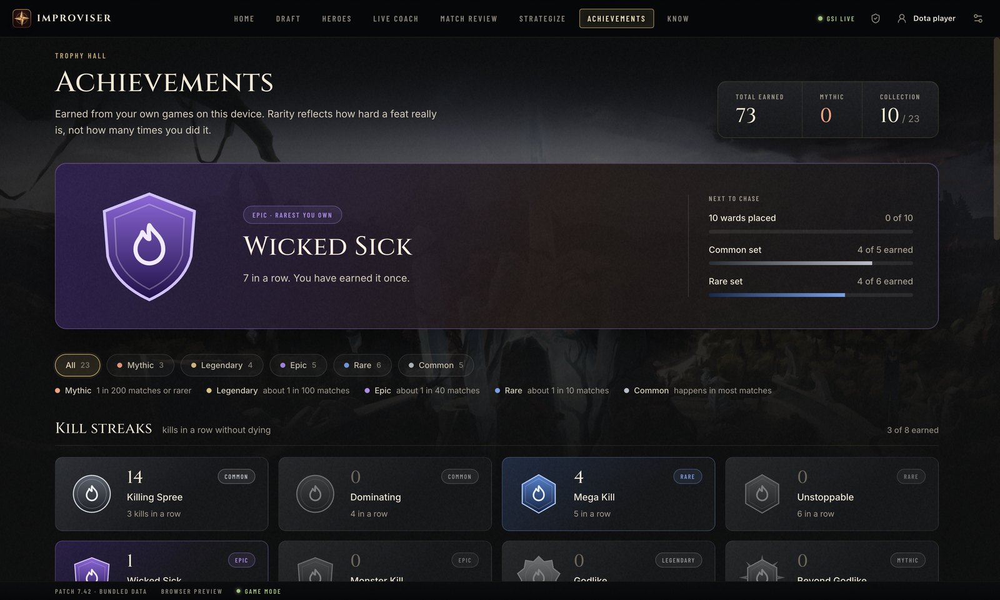 |
| Every ability with its tags, plus computed stats by level | Five rarity tiers, from your own games |
| **Know** | **Overlay setup** |
| 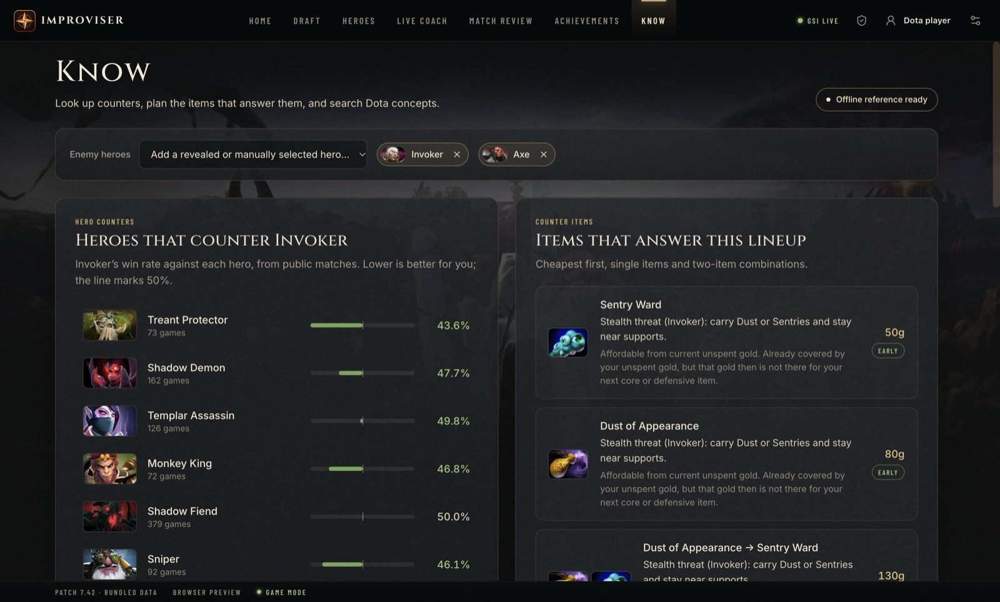 |  |
| Who counters a hero and which items answer a lineup | Live Coach → Overlay setup: pick-phase, compact and large cards |

### Match Review

| Story | Replay |
| :---: | :---: |
| 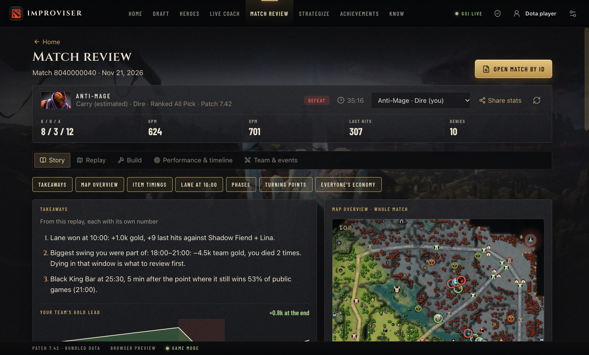 | 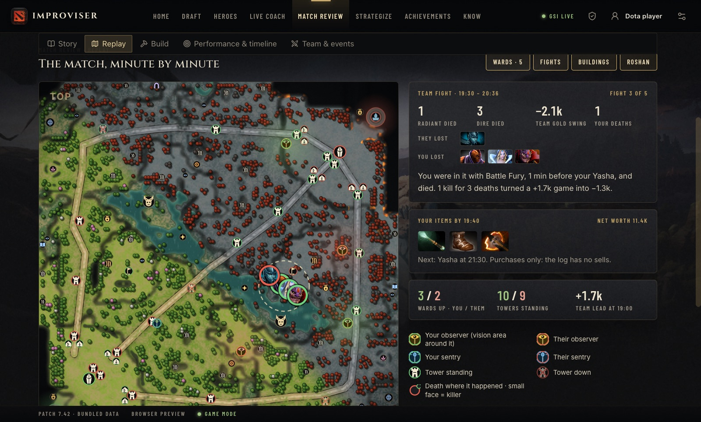 |
| Takeaways with their numbers, the team gold lead with turning points, item timings marked elite / on time / late | Scrub or play the match: wards up, towers, each fight with its kill feed in a rail beside the map |
| **Build** | **Team & events** |
| 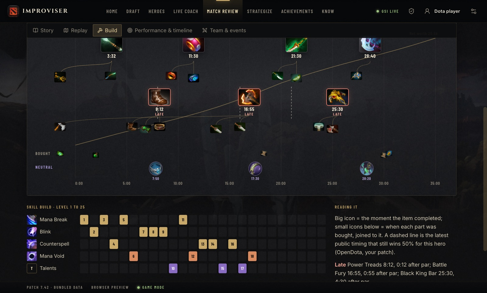 | 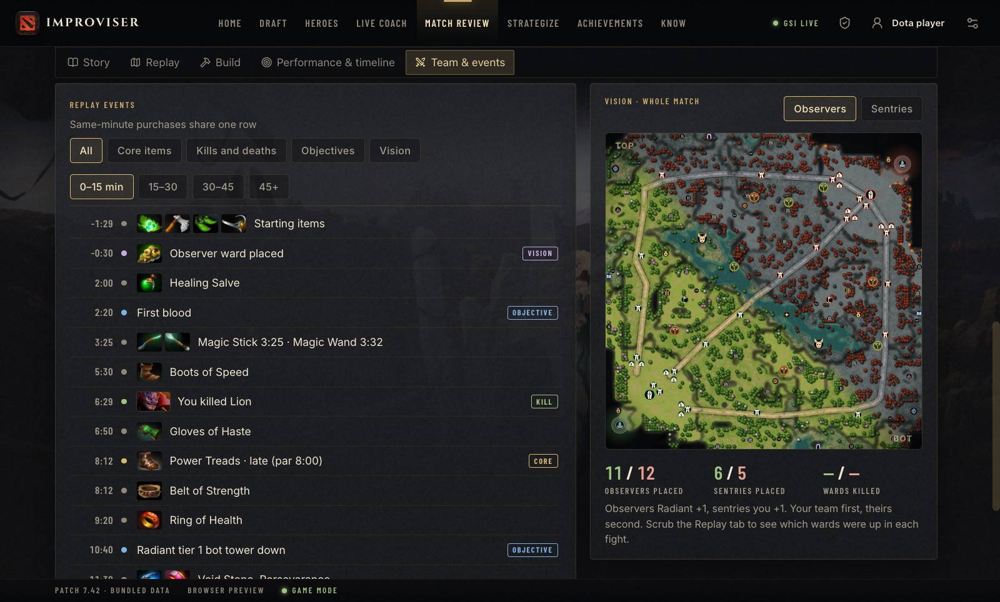 |
| Items and their components on a time axis vs public par, then the level 1–25 skill grid | Purchases, kills and objectives by minute, beside where each team warded |

### Strategize and chat

| Strategize | Chat translation |
| :---: | :---: |
| 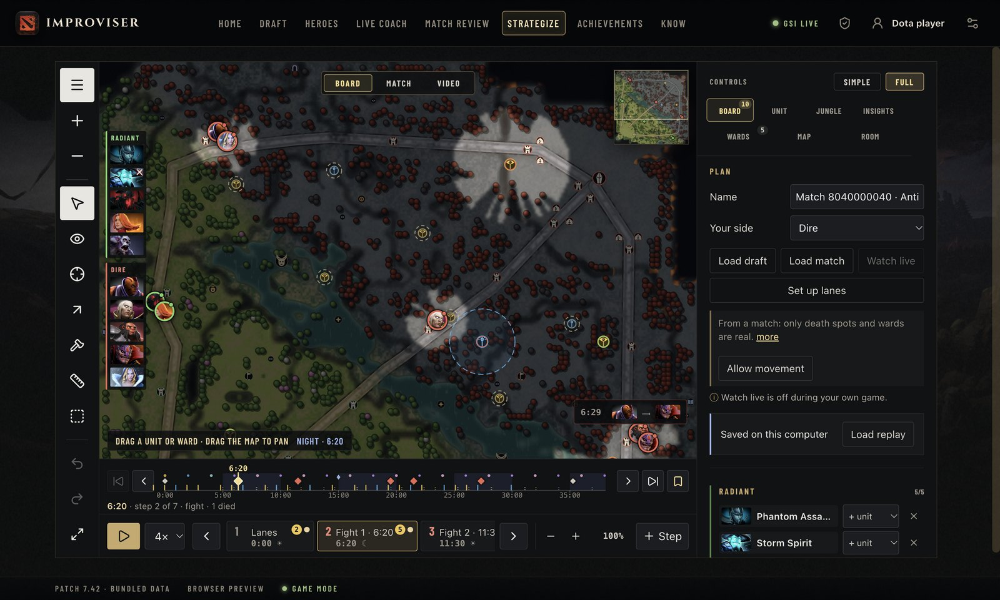 | 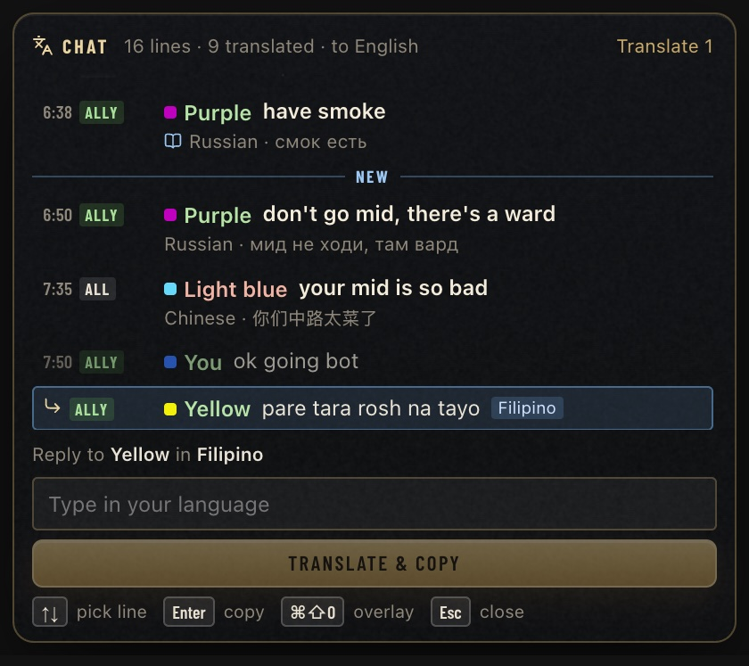 |
| A planning board on Dota's own map: heroes, wards with real vision, arrows, steps you play back. Plan live with teammates in a room that needs its code and a 4-digit PIN | Ctrl/⌘+Shift+T in a match: chat in other languages translated, your reply translated and copied for you to paste |

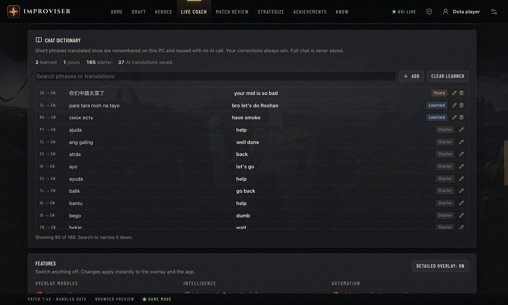 Chat dictionary: phrases it already knows are translated on your PC with no AI call; correct any of them

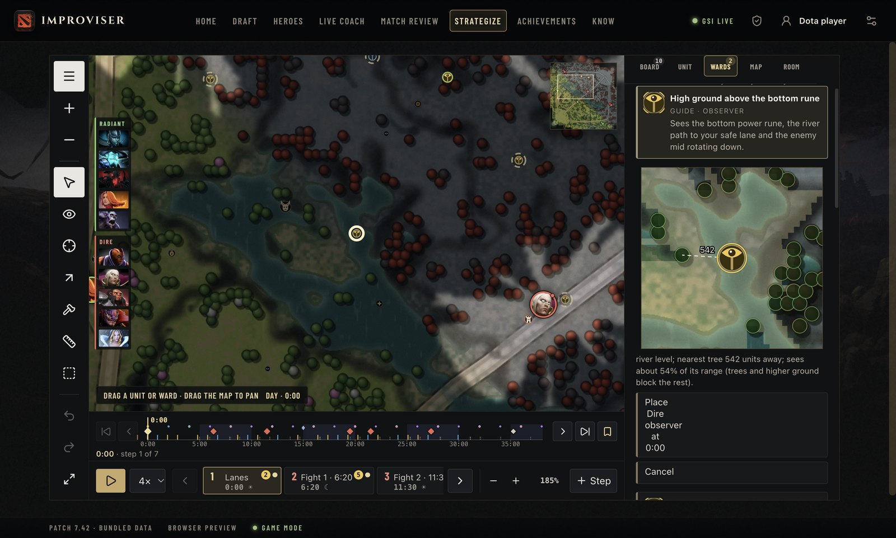 Ward plan: pick a spot and see the exact cell zoomed in on the real map: trees around it, what an observer there sees, the nearest tree, and a better cell when your wards keep getting found

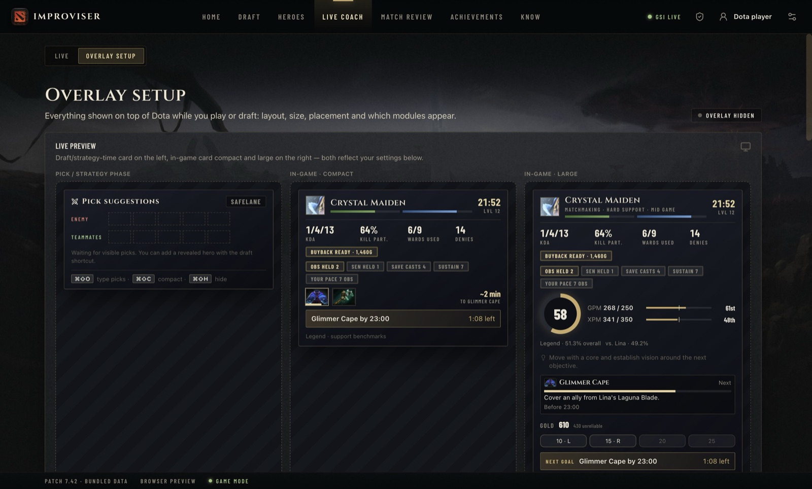 Support view: graded on wards, saves and kill participation instead of last hits

Screenshots use the browser preview's made-up sample games, not a real player's data.

## What it does

- **Helps you draft** — shows counters, matchup win rates, and what your team is missing, before the game even starts.
- **Coaches you live** — a small overlay on top of Dota with your stats, a live win estimate, item suggestions for what you're facing, and reminders for runes, day/night, and stacking.
- **Reviews your games** — after the match, from OpenDota's parsed replay: three takeaways with their numbers, a schematic map you can scrub through (wards, team fights, towers), your build on a time axis against the public par time, your skill order, and every purchase, kill and objective by minute. It never draws anything the replay doesn't have.
- **Understands supports** — pick Support or Hard support and the overlay stops grading you on last hits. It shows ward charges used and still on your hero, save and sustain item casts (Force Staff, Eul's, Glimmer, Mekansm and similar), denies and kill participation, with a lane job that changes by the minute (harass and deny, pull, stack, runes). After the game, Match Review adds a support report from the replay: how long your observers survived, how many were dewarded, dewards, stacks, healing, and any save item you bought but never pressed, compared with your own earlier support games. It learns where your wards stand from your saved replays: how long they lasted, how often and how fast the enemy found them (and which heroes did), and how many enemy deaths each spot's vision covered. The overlay's ward map knows your lane (where you stand, else your role), ranks spots you keep losing lower, marks a better nearby cell, and shows where the enemy keeps warding you.
- **Knows the game mode** — ranked games are compared with ranked games only, Turbo is kept apart so it never inflates your averages, and ranked results count most when it learns.
- **Single Draft and Ability Draft help** — enter (or, experimentally, let it read from your screen) the heroes Single Draft offers you and it ranks just those against your team and the enemy, with the lanes each one fits. In Ability Draft it sorts the whole ability pool by what each ability does.
- **Gets out of Dota's way** — while you draft or play, the dashboard steps back (fewer updates, background checks paused, and the animations, moving background and blur you choose in Settings switched off) so Dota and the overlay get the resources. A "Game mode" badge shows when it's doing this.
- **Tracks your achievements** — kill streaks, multi-kills, milestones, and per-hero goals, all in one trophy case.
- **Learns and adapts as you play** — every match you finish retrains your own profile: which heroes you're actually comfortable on, which items have genuinely worked out for you, and your real record against lineups shaped like the one you're facing. It starts adapting from your first few games rather than waiting for dozens: a small history nudges advice a little, 10–15 matches nudge it properly. Older matches matter less over time, and matches from before a Dota patch count for even less, so your advice doesn't get stuck on outdated patch habits. It remembers a compact record of the last 8 patches (hero win and pick rates, what each ability does, item costs), so it can show how a hero has trended across patches and exactly what changed in its kit, and an old game on a hero that was reworked since counts for much less than one on a hero that barely changed. This is private per player — your own learning never mixes with or affects anyone else using the app.
- **Plans builds against the future** — the Planner simulator compares two items at a minute you pick (say Desolator vs Force Staff on Phantom Assassin at 20:00) against a chosen enemy: stat changes, damage and time-to-kill, effective HP, when you can afford it, and the real public win rate for buying it around then. Saved builds are flagged for review when a patch changes one of their items.
- **Finds games like this one** — Match Review lists your most similar past games (same hero, overlapping enemy lineup, similar item timings) and how they went, and your item habits show your win rate when on time vs late against the public par time.
- **Plans with your team** — Strategize is a planning board on Dota's own map: put both lineups in lane, place wards (with their real vision through trees and high ground), draw arrows, and step through the plan like chess moves, played back at each hero's real speed. Host a room and up to 19 teammates can plan with you live: they join with the room code and a 4-digit PIN, and the Share button copies an invite ready to paste into Discord or Steam chat.
- **Replays past matches like you're watching them** — Strategize's video mode downloads a finished match's replay from Valve on request, reads it on your PC, and plays every hero's real movement back with wards, kills, fights and objectives at 0.5×–16×. Pause anywhere and turn that moment into a plan, or watch it together in a room. Only finished matches, never during your own game; Valve keeps replays for a limited time.
- **Translates in-game chat** — spots chat in other languages; Ctrl/⌘+Shift+T shows the whole match translated and keeps translating while it's open. Reply in your language and it's translated and copied for you to paste. A phrase dictionary learns as you go, so repeats cost nothing.
- **Has an optional AI assistant** — ask it a question about your draft or your current game, if you want a second opinion. In game its answer stays pinned on screen while you keep playing, until you press Ctrl/⌘+Shift+O.
- **Stays out of the way** — closes to the system tray, follows Dota's window automatically, and never covers more than a small corner of your screen.

## Keeping it fair

- Only uses what you could already see yourself: public stats, Dota's own opt-in live feed, your own local files, and whatever you type in.
- Never reads hidden information, never touches game memory, never clicks or types for you.
- One narrow, opt-in exception reads hero portraits from *your own screen* during hero picks — the pick bar, plus your offered heroes in Single Draft — since Dota doesn't otherwise tell you who got picked. Off by default, and never used once a game is live.
- **Chat translation (on demand):** chat comes from Dota's own live feed, not from your screen. The app spots lines in another language locally; press Ctrl/⌘ + Shift + T to translate them through your own Puter account. Replies are translated and copied for you to paste: the app never types or sends anything in Dota. Short phrases it has translated (and your corrections) are remembered on your PC, so repeats like "gg" or "спасибо" cost no AI call; a starter set of common Dota chat phrases ships with it.
- During a live match it never shows anything the game hides from you: no enemy positions, no tower or Roshan state (those appear in Match Review after the game).
- The maps use Dota's own minimap, read from your installed game files and shown only on your computer (never bundled or uploaded); without Dota installed, the app paints its own map from public map data.
- Strategize rooms are opt-in planning boards shared directly between players' apps. Joining needs the room code and the host's 4-digit PIN. A public PeerJS service only introduces the apps; the room shares the board and each member's Steam name, never anything from your game, and ends when the host closes it.

More detail, if you want it: [Privacy and fair-play notes](docs/privacy-and-safety.md).

## Install

Pictures for each step, including the security warnings: [install guide on the website](https://dotaimproviser.pages.dev/install).

1. **[Download the latest release](https://github.com/abhibizz158/dota-improviser/releases/latest)** — pick the macOS `.pkg` or Windows `.exe`.
2. **macOS:** open the `.pkg` and install. **Windows:** run the installer and choose where to install it (updates reuse that folder; run the installer again and pick another folder to move the app).
3. Open it. A short first-run setup walks you through linking your account, connecting the game feed (with a one-click copy of the launch option), your usual role, and the permissions your OS needs. Every step is optional, and you can reopen it from Settings → Setup guide.

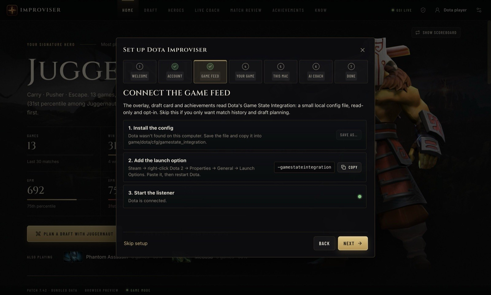

**Storage and uninstall** (Settings): see where the app and your data live, move your data to another folder (the app copies everything, checks it, then removes the old folder), or uninstall. On Windows that opens the uninstaller, which asks whether to delete your data; on macOS the app moves to the Trash, with your data if you tick the box.

The app checks for updates itself and installs them quietly in the background once you approve. Your downloaded hero data stays across updates: an update only re-downloads what has actually changed.

## Contact

Website: [dotaimproviser.pages.dev](https://dotaimproviser.pages.dev/) ([help and contact form](https://dotaimproviser.pages.dev/support)).

Questions, problems or ideas: [abhishekbizz.156@gmail.com](mailto:abhishekbizz.156@gmail.com) or [open an issue](https://github.com/abhibizz158/dota-improviser/issues). Security problems: see [SECURITY.md](SECURITY.md).

## License

Copyright © 2026 abhibizz158. All rights reserved. This is **not** open source. The [Dota Improviser Personal Use License](LICENSE) lets you use official releases and the [website](https://dotaimproviser.pages.dev/) for your own, non-commercial use ([summary](https://dotaimproviser.pages.dev/terms)). Without written permission:

- **No copying or redistribution**: no mirrors, re-uploads, repackaged or modified builds. Share the official link instead.
- **No commercial use**: no selling, paid services, paid coaching or analytics, ads or bundling.
- **No reverse engineering**: no decompiling, deobfuscating or unpacking the installers, app, website or demo, beyond rights the law does not let anyone remove.
- **No AI or automated extraction**: no using AI assistants, agents or crawlers to extract, rebuild or port it, and no use as training or text-and-data-mining material.

Permission requests and misuse reports: [abhishekbizz.156@gmail.com](mailto:abhishekbizz.156@gmail.com). Third-party credits: [licenses/README.md](licenses/README.md).
